# Working solution: run it and see it work

**Repo:** this repository (`backend/`, `frontend/`, `docker-compose.yml`).
**No hosted link:** it runs on your machine with Docker. This page is the recorded walkthrough, with
real screenshots taken from the running app.

## Run it (3 commands)
Needs Docker (with Compose) and GNU Make.

```sh
cp .env.example .env     # then put your Gemini key in GEMINI_API_KEY (optional)
make up                  # builds and starts everything; wait about 45 seconds
make seed                # creates an admin and an operator (logins are printed)
```

Open **http://127.0.0.1:3000**. The AI part needs a Gemini key; everything else works without one.

## What you will see

### 1. Sign in
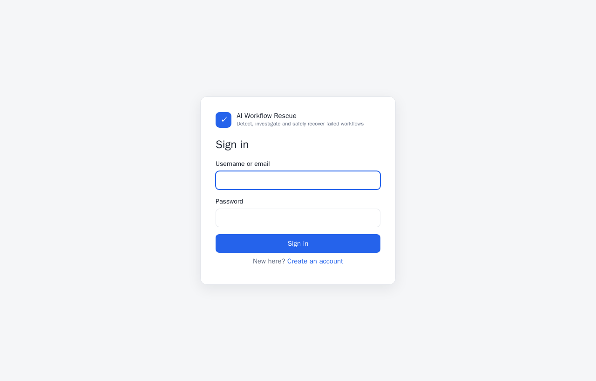

### 2. The dashboard
Counts by status, what needs attention, and a warning if stock is held by failed orders.
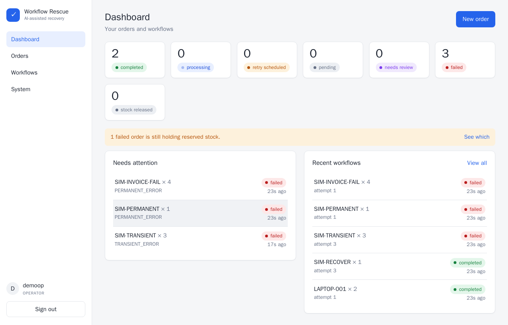

### 3. Place an order, choosing how it should fail
Each card is a failure on purpose (a product ID decides what goes wrong).
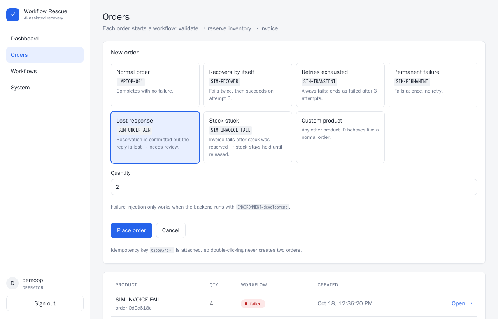

### 4. The hard case: work done, reply lost
The order stops in **needs review**. The stock really was reserved, but the system will not guess.
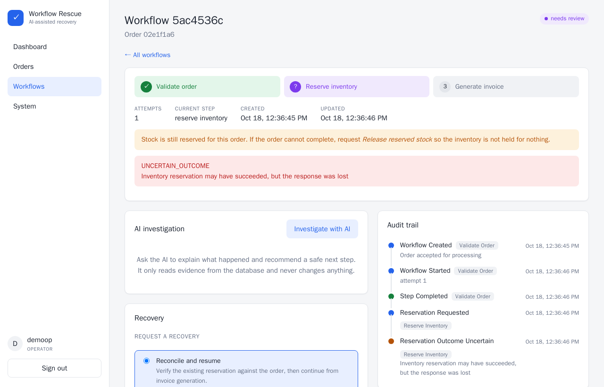

### 5. Ask the AI
One click gives the root cause, the evidence it used (each reference is checked), and a recommended
action. The recovery form is pre-selected and linked to this advice.
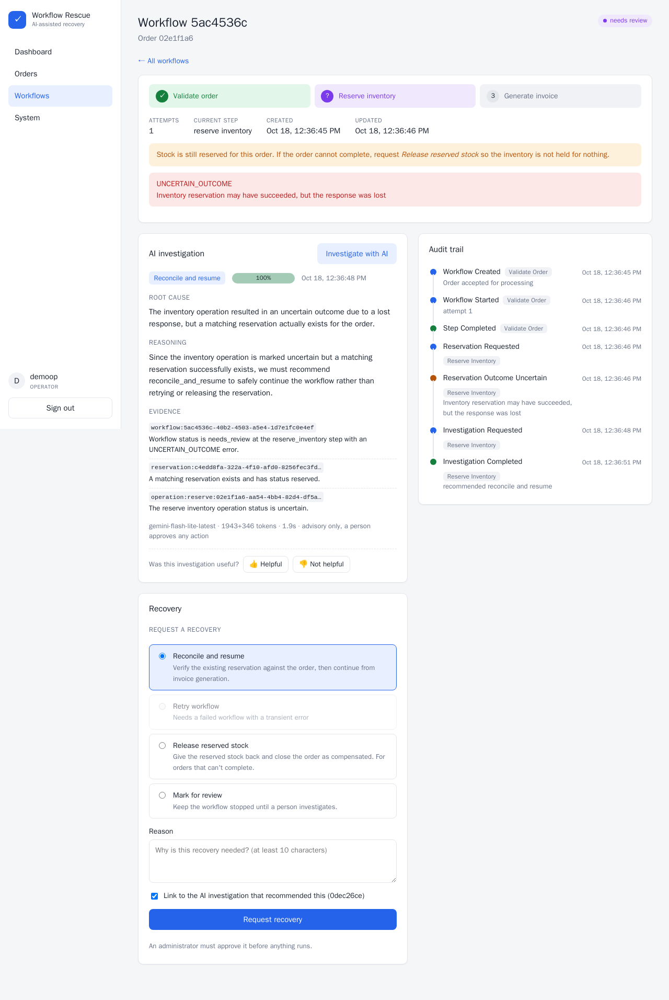

### 6. An admin approves
Only an admin, and never the person who made the request.
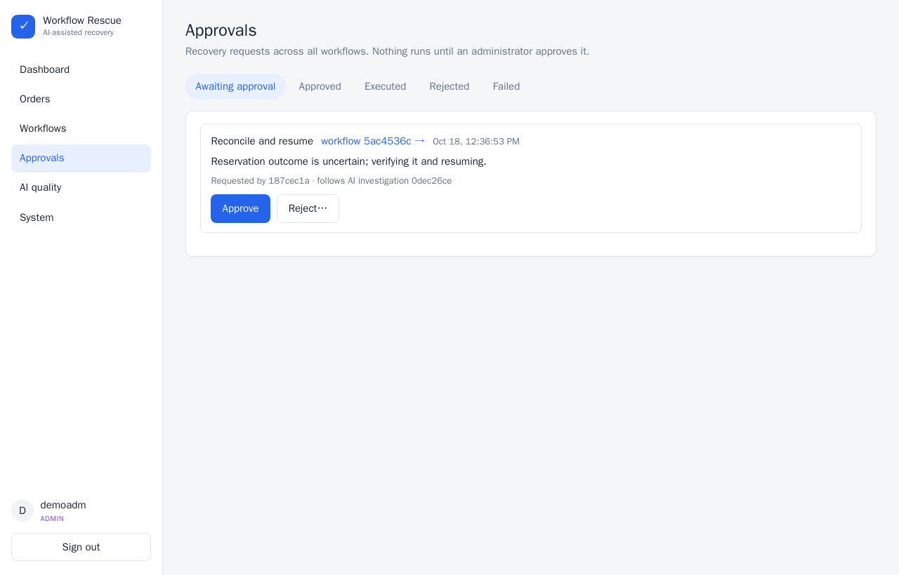

### 7. Recovered, with a full audit trail
The system checked the reservation, then finished the order. **One reservation, one invoice.**
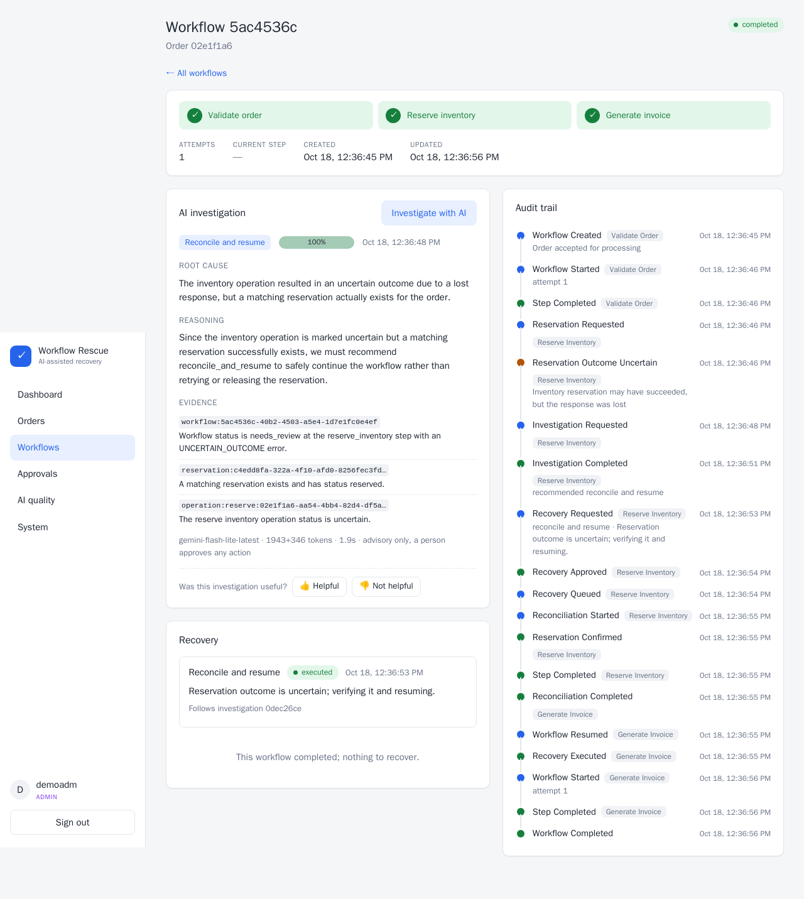

### 8. Stock held for an order that cannot finish
The invoice failed after stock was reserved. The dashboard warns about it.
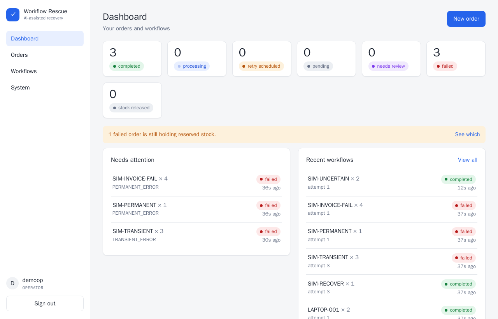

### 9. Releasing the stock
An approved "release" gives the inventory back and closes the order as *compensated*.
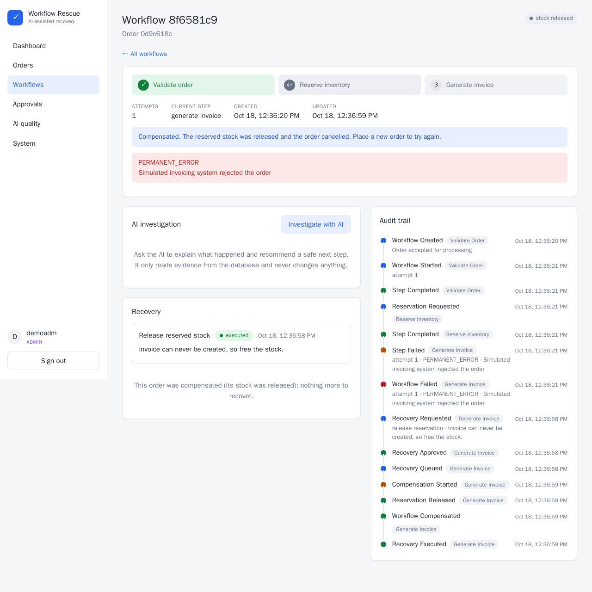

### 10. Is the AI any good? (admin)
How often its advice was followed, whether it worked, how often the safety rules had to change its
answer, and whether higher confidence really meant better results.
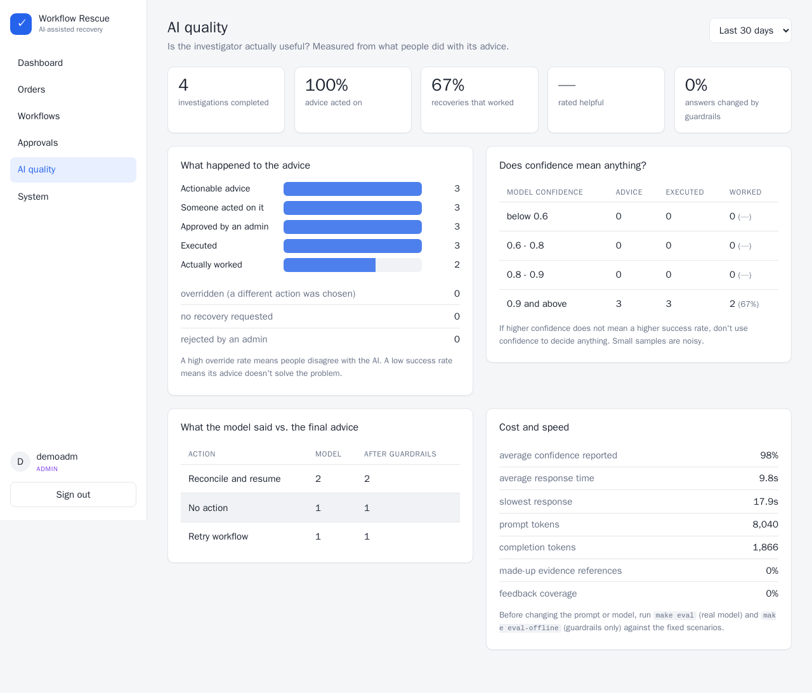

### 11. System health
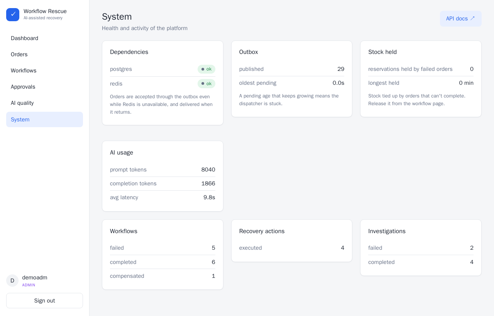

## Check it yourself from the command line
```sh
make scenarios                       # runs every failure type, prints a pass/fail table
make demo DEMO_ARGS=--investigate    # the whole lost-response recovery, with the AI step
make eval-offline                    # throws 200 bad AI answers at the safety rules (no key needed)
make eval                            # asks the real model about 10 fixed scenarios
```

## What each failure type does
| Product ID | What goes wrong | Ends as |
|---|---|---|
| `LAPTOP-001` | nothing | completed |
| `SIM-RECOVER` | temporary failure twice | completed by itself |
| `SIM-TRANSIENT` | temporary failure forever | failed after 3 tries |
| `SIM-PERMANENT` | request can never work | failed at once |
| `SIM-UNCERTAIN` | work done, reply lost | needs review, then completed after approval |
| `SIM-INVOICE-FAIL` | invoice fails after stock reserved | failed, then stock released |

## Try the "Redis is down" case
```sh
docker compose stop redis      # place an order in the UI: it is still accepted
docker compose start redis     # within about a minute it completes by itself
```

More detail: `README.md`, `docs/architecture.md`, `docs/failure_scenarios.md`.
